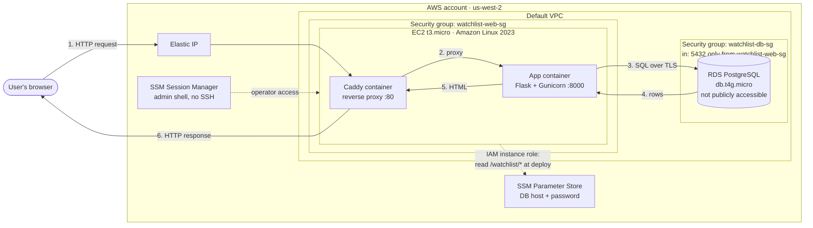

# Watch List on AWS

A small database-backed web app (a watch list of movies and shows) deployed on a Linux EC2 instance with an RDS PostgreSQL database.

- **Live app:** http://52.26.62.90
- **Health check:** http://52.26.62.90/health

---

## Architecture



**How a request travels:**
1. The browser sends a request to the instance's **Elastic IP**. The security group `watchlist-web-sg` allows only ports 80/443 in.
2. **Caddy**, a reverse proxy in its own container, receives the request and forwards it to the **app container** on port 8000. That port isn't published to the host, so it's reachable only on the internal Docker network.
3. The app opens a TLS connection to **RDS PostgreSQL** on port 5432. RDS has no public IP, and its security group accepts only traffic from `watchlist-web-sg`.
4. Postgres returns the rows to the app.
5. The app renders the HTML page and hands it back to Caddy.
6. Caddy sends the response back to the browser.

The database password never travels with requests. At deploy time, `deploy.sh` reads it from **SSM Parameter Store** using the instance's IAM role (no AWS keys on the server) and writes it to a root-only `.env` file. Admin access to the server is through **SSM Session Manager**, so no SSH port is open.

**Why Docker (optional extra):** the same image runs on my laptop and on EC2, so "works locally" means "works in production." Docker's restart policy brings the app back after a crash or reboot, and its health check calls `/health` to flag the app if it stops working.

---

## Run it locally

Requires Docker.

```bash
docker compose up --build
```

Then open http://localhost:8000 (the app) and http://localhost:8000/health (the health check).

---

## How I deployed it

Region: **us-west-2 (Oregon)**.

### 1. Security groups (EC2 → Security Groups)
- `watchlist-web-sg`: inbound **HTTP 80** and **HTTPS 443** from `0.0.0.0/0` and `::/0`. No SSH rule.
- `watchlist-db-sg`: inbound **PostgreSQL 5432**, with the **source set to `watchlist-web-sg`** (the security group, not an IP). No outbound rules.

### 2. RDS (RDS → Create database → Full configuration)
- Engine **PostgreSQL**, template **Free tier**, Single-AZ
- Identifier `watchlist-db`, master username `watchlist`, **Self managed** password
- Instance **db.t4g.micro**, **20 GiB** storage, storage autoscaling off
- **Public access: No**, VPC security group **`watchlist-db-sg`** only
- Initial database name `watchlist`, backup retention 1 day, encryption on, Enhanced Monitoring off

### 3. Parameter Store (Systems Manager → Parameter Store)

| Name | Type | Value |
|---|---|---|
| `/watchlist/db_host` | String | the RDS endpoint |
| `/watchlist/db_password` | SecureString | the database password |

### 4. IAM role for the instance (IAM → Roles → Create role)
- Trusted entity **AWS service → EC2**
- Attach **`AmazonSSMManagedInstanceCore`** (for Session Manager)
- Add an inline policy from [`deploy/iam/ec2-instance-policy.json`](deploy/iam/ec2-instance-policy.json) that allows reading only `/watchlist/*` parameters
- Name: `watchlist-ec2-role`

### 5. Launch the instance (EC2 → Launch instance)
- Name `watchlist-web`, AMI **Amazon Linux 2023 (x86_64)**, type **t3.micro**
- Key pair: **none** (Session Manager instead of SSH)
- Network: default VPC, auto-assign public IP on, security group **`watchlist-web-sg`**
- Storage: 8 GiB gp3
- Advanced details: IAM instance profile **`watchlist-ec2-role`**, metadata version **V2 only**, **User data** = contents of [`deploy/bootstrap.sh`](deploy/bootstrap.sh)
- After launch: **Elastic IPs → Allocate → Associate** with the instance, so the address doesn't change on stop/start. Under **Change credit specification**, turn off T3 **Unlimited** so CPU bursting can't add charges.

On first boot, `bootstrap.sh`:
1. installs Docker and the Compose plugin
2. adds a 1 GB swap file
3. clones this repo to `/opt/watchlist`
4. runs `deploy.sh`

`deploy.sh`:
1. pulls `main`
2. reads the database settings from Parameter Store and writes `.env`
3. builds the image and starts the Caddy and app containers
4. waits until `/health` responds **through Caddy**, and fails the deploy if it doesn't

### Redeploying

From a Session Manager shell (EC2 → Connect → Session Manager):

```bash
sudo /opt/watchlist/deploy/deploy.sh
```
