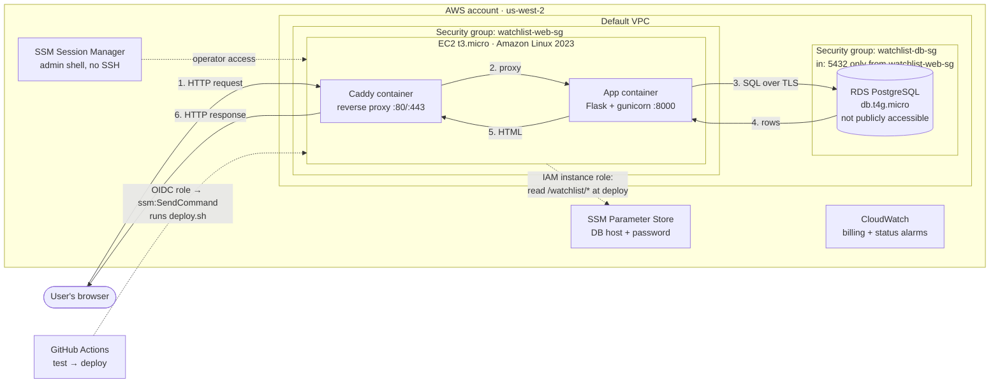

# 🎬 Watch List on AWS

A small database-backed web app (a watch list of movies and shows) deployed on a Linux EC2 instance with an RDS PostgreSQL database. The app is deliberately simple. The focus is on **how it's deployed and run**: least-privilege networking, no secrets in Git, automated deploys and health checks, all inside the AWS Free Tier.

- **Live app:** `http://CHANGE-ME` <!-- fill in -->
- **Health check:** `http://CHANGE-ME/health`
- **Demo video:** CHANGE-ME

| Path | What it does |
|---|---|
| `GET /` | Shows the list (unwatched first) |
| `POST /items` | Adds a title (movie or show) |
| `POST /items/<id>/toggle` | Marks it watched or unwatched |
| `POST /items/<id>/delete` | Removes it |
| `GET /health` | `200 {"status":"ok","database":"ok",...}` if the app can run `SELECT 1` on the database, `503` if not |

---

## Architecture



**How a request travels:**
1. The browser connects to the instance's Elastic IP. The security group allows only ports 80/443.
2. **Caddy** receives the request and forwards it to the **app container** on port 8000. That port isn't published to the host, so it's reachable only on the internal Docker network.
3. The app opens a TLS connection to **RDS** on 5432. RDS has no public IP, and its security group accepts only traffic coming from the web server's security group.
4. Postgres returns the rows, the app renders HTML, and Caddy sends it back to the browser.

The database password never travels with requests. `deploy.sh` reads it from **SSM Parameter Store** once, at deploy time, using the instance's IAM role, and writes it to a root-only `.env` file on the instance.

---

## Main choices (and what I didn't pick)

| Decision | Chose | Considered | Why |
|---|---|---|---|
| Compute | **EC2 t3.micro** | t2.micro, t4g (ARM) | Free-tier eligible. Newer generation than t2, and 1 GB RAM is plenty with a small swap file. |
| Linux distro | **Amazon Linux 2023** | Ubuntu 24.04 | Comes with the SSM agent and AWS CLI preinstalled and gets security patches from AWS. Ubuntu would work just as well. |
| Database | **RDS PostgreSQL** | Postgres in a container on the same EC2; DynamoDB | Managed backups, patching and encryption at rest, and the database survives if the instance dies. Same-box Postgres is simpler but loses data with the instance and adds memory pressure on 1 GB. DynamoDB is free and serverless, but a relational table fits the data and SQL is easier to reason about. |
| Traffic path | **Elastic IP → EC2, Caddy reverse proxy** | Application Load Balancer | An ALB adds cost and complexity for a single instance. Caddy handles HTTPS on its own (automatic Let's Encrypt). An ALB becomes worth it with 2+ instances. |
| Packaging | **Docker + Compose** | systemd + virtualenv | The same image runs in CI, locally and on EC2. Restart policies and health checks come built in. |
| Admin access | **SSM Session Manager** | SSH with a key pair | No port 22 open, no keys to lose, and sessions are logged under IAM identity. |
| Secrets | **SSM Parameter Store (SecureString)** | Secrets Manager; env vars in Git | Parameter Store's standard tier is free and KMS-encrypted. Secrets Manager adds rotation but costs $0.40/secret/month. Secrets in Git: never. |
| CI/CD | **GitHub Actions → OIDC → SSM Run Command** | SSH from Actions with a stored key; CodeDeploy | No long-lived AWS keys or SSH keys stored in GitHub. The deploy role can only run commands on this one instance. CodeDeploy is heavier than this needs. |

**Extras I picked:** Docker and CI/CD. Docker gives one consistent artifact from my laptop to production. CI/CD means every push to `main` is tested against a real Postgres before it's deployed, and a failed health check fails the deploy. Both appear in MangoApps' day-to-day stack.

---

## Security

- **Network:** the web security group opens only 80/443. **No SSH (22) is open.** RDS is *not publicly accessible* and accepts 5432 only from the web security group (security group reference, not an IP range).
- **No secrets in Git:** `.env` is git-ignored. The database password lives only in Parameter Store (SecureString) and in a `chmod 600` file on the instance. No AWS access keys exist anywhere: EC2 uses an **instance role**, and GitHub Actions uses **OIDC** short-lived credentials.
- **Least-privilege IAM:** the instance role can read only `/watchlist/*` parameters (plus `AmazonSSMManagedInstanceCore` for Session Manager). The GitHub role can only `SendCommand` to this instance. See [`deploy/iam/`](deploy/iam).
- **Instance hardening:** IMDSv2 required, encrypted EBS, and the app container runs as a non-root user.
- **Database:** encrypted at rest. The app connects with `sslmode=require` (RDS enforces TLS).
- **App:** parameterized SQL (no SQL injection), Jinja autoescaping (no XSS, covered by a test), input length and type validation, and security headers. `/health` doesn't leak error details; those go to the logs.

## Staying in the free tier

- **One t3.micro** EC2 instance (750 hrs/month), **one db.t4g.micro** RDS instance (single-AZ, 20 GB gp2, 1-day backups, no Performance Insights or Enhanced Monitoring), **one** public IPv4/Elastic IP attached to a running instance.
- **Not used (common surprise bills):** NAT Gateway, ALB, Multi-AZ RDS, Secrets Manager, idle Elastic IPs.
- **Guardrails:** an AWS Budgets zero-spend budget plus a CloudWatch billing alarm that emails me. Every resource is tagged `project=watchlist` so cleanup is easy.

---

## Run it locally

```bash
docker compose up --build
# open http://localhost:8000  and  http://localhost:8000/health
```

Run the tests (needs a Postgres; the compose one works):

```bash
docker compose up -d db
python -m venv .venv && . .venv/bin/activate && pip install -r requirements-dev.txt
DB_HOST=localhost DB_PASSWORD=localdev pytest -v
```

(For the tests to reach the compose database, add `ports: ["5432:5432"]` to the `db` service.)

---

## How I deployed it (runbook)

Region: **us-west-2 (Oregon)**. Tag everything `project=watchlist`.

### 0. Guardrails
- **Billing → Budgets → Create budget → "Zero spend budget"** template, with your email.
- **Billing preferences:** turn on CloudWatch billing alerts and free-tier usage alerts.
- Use an IAM user with MFA, not the root account.

### 1. Security groups (EC2 → Security Groups)
- `watchlist-web-sg`: inbound **HTTP 80** and **HTTPS 443** from `0.0.0.0/0` and `::/0`. **No SSH rule.**
- `watchlist-db-sg`: inbound **PostgreSQL 5432**, source = **`watchlist-web-sg`** (pick the security group, not an IP).

### 2. RDS (RDS → Create database)
- Standard create → **PostgreSQL 16** → Template **Free tier**
- Identifier `watchlist-db`, master username `watchlist`, **Self managed** credentials, strong password (save it in a password manager for now)
- Instance **db.t4g.micro** (or db.t3.micro), storage **20 GB gp2**, **storage autoscaling off**
- Connectivity: default VPC, **Public access: No**, VPC security group **`watchlist-db-sg`** (remove `default`)
- Additional configuration: **Initial database name `watchlist`**, backup retention 1 day, encryption on, **Performance Insights off**, **Enhanced monitoring off**
- When it's *Available*, copy the **Endpoint**.

### 3. Parameters (Systems Manager → Parameter Store)
| Name | Type | Value |
|---|---|---|
| `/watchlist/db_host` | String | the RDS endpoint |
| `/watchlist/db_password` | **SecureString** (default `aws/ssm` key) | the master password |
| `/watchlist/site_address` | String *(optional, for HTTPS)* | e.g. `mywatchlist.duckdns.org` |

### 4. IAM role for the instance (IAM → Roles → Create)
- Trusted entity **EC2**, attach **`AmazonSSMManagedInstanceCore`**
- Add an inline policy from [`deploy/iam/ec2-instance-policy.json`](deploy/iam/ec2-instance-policy.json) (replace `ACCOUNT_ID`)
- Name: `watchlist-ec2-role`

### 5. Launch the instance (EC2 → Launch instance)
- Name `watchlist-web`, AMI **Amazon Linux 2023 (x86_64)**, type **t3.micro**
- Key pair: **Proceed without a key pair** (we use Session Manager)
- Network: default VPC, auto-assign public IP **on**, security group **`watchlist-web-sg`**
- Storage: 8 GiB gp3, encrypted
- Advanced details: IAM instance profile **`watchlist-ec2-role`**, Metadata version **V2 only**, **User data** = contents of [`deploy/bootstrap.sh`](deploy/bootstrap.sh) with `REPO_URL` set to this repo
- Launch, then **Elastic IPs → Allocate → Associate** with the instance so the link doesn't change on stop/start.

After about 3–5 minutes, `http://<elastic-ip>/` and `/health` should respond.

**If it doesn't:** EC2 → Connect → **Session Manager**, then:
```bash
sudo tail -100 /var/log/watchlist-bootstrap.log     # bootstrap output
sudo docker ps                                       # are both containers up / healthy?
sudo docker logs watchlist-app-1 --tail 50           # app + DB connection errors
```

### 6. Redeploying by hand
```bash
sudo /opt/watchlist/deploy/deploy.sh
```
It pulls `main`, regenerates `.env` from Parameter Store, rebuilds, restarts, and **fails unless the health check goes green**.

### 7. Optional: HTTPS
Point a free DuckDNS (or Route 53) name at the Elastic IP, set `/watchlist/site_address` to that name, and redeploy. Caddy gets a Let's Encrypt certificate and redirects HTTP to HTTPS.

### 8. Optional: deploy on every push (GitHub Actions)
1. IAM → Identity providers → add **OpenID Connect**: URL `https://token.actions.githubusercontent.com`, audience `sts.amazonaws.com`.
2. Create role `watchlist-github-deploy` with the trust policy in [`deploy/iam/github-oidc-trust.json`](deploy/iam/github-oidc-trust.json) and the permissions in [`deploy/iam/github-deploy-policy.json`](deploy/iam/github-deploy-policy.json) (fill in the placeholders).
3. GitHub repo → Settings → Secrets and variables → Actions → **Variables**: `AWS_ROLE_ARN`, `AWS_REGION`, `EC2_INSTANCE_ID`. (None of these are secrets; there are no AWS keys.)

Every push now runs the tests against a real Postgres, builds the image, then runs `deploy.sh` on the instance through SSM. Pull requests run tests only.

### 9. Monitoring
- **CloudWatch alarm** on the EC2 metric `StatusCheckFailed_System` with the **Recover instance** action plus an SNS email.
- Docker restarts the containers if they crash (`restart: unless-stopped`), and the image's `HEALTHCHECK` marks the app unhealthy if `/health` fails.

### Cleanup (after review)
Terminate the instance, **release the Elastic IP**, delete the RDS instance (skip the final snapshot), and delete the parameters, roles and security groups.

---

## What went wrong (and how I found the cause)

<!-- Write your real story here: symptom → what you checked → actual root cause → fix. -->

## Before real customers use it

- **High availability:** an ALB across two AZs, an Auto Scaling group of 2+ instances, and Multi-AZ RDS. Right now one instance or AZ failure means downtime.
- **HTTPS everywhere** with ACM certificates on the ALB, plus a real domain in Route 53.
- **Private subnets:** move app instances behind the ALB with no public IPs (VPC endpoints or a NAT for outbound traffic).
- **Infrastructure as code:** everything above as Terraform, so environments are reproducible and changes get reviewed.
- **Images in ECR** built once in CI and promoted, instead of building on the server, plus zero-downtime (rolling or blue/green) deploys.
- **Secrets:** Secrets Manager with automatic rotation, or RDS IAM authentication, and `sslmode=verify-full` with the RDS CA.
- **Observability:** ship logs to CloudWatch Logs, add an external uptime check on `/health` that pages someone, and dashboards for latency, errors and database connections.
- **App:** user accounts and authentication, CSRF protection, rate limiting, a connection pool, and versioned schema migrations (Alembic).
- **Backups:** longer RDS retention plus a tested restore procedure.
